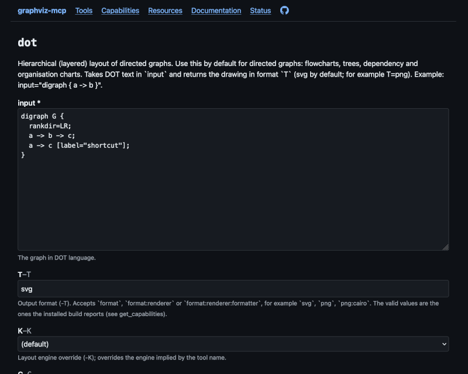

# Graphviz MCP

An [MCP](https://modelcontextprotocol.io/) server that gives AI assistants access to the full [Graphviz](https://graphviz.org/) tool suite, including layout engines (`dot`, `neato`, `fdp`, etc.) and graph-processing utilities (`ccomps`, `tred`, `gvpack`, etc.).

[](https://github.com/rodw/graphviz-mcp/actions/workflows/ci.yml)
[](https://github.com/rodw/graphviz-mcp/releases)
[](LICENSE)

Graphviz-MCP ships as a single Docker image, containing a complete, stand-alone instance of Graphviz, so that nothing needs to be installed on the host. A given graphviz-mcp image always has the same tools, engines, output formats and fonts, which keeps capabilities predictable and rendered output reproducible from one machine to the next. 

Published versions of the Docker image are available on the GitHub Container Registry at [ghcr.io/rodw/graphviz-mcp](https://github.com/rodw/graphviz-mcp/pkgs/container/graphviz-mcp). 

Graphviz-MCP can also be readily built and run directly from a clone of [this git repository](https://github.com/rodw/graphviz-mcp/).

## Overview

Each Graphviz binary is exposed as an [MCP tool](#tools) with the same name, with parameters named after the corresponding command-line flags. If you already know Graphviz, you know the API.

Calls are stateless. The graph goes in as a string and the result comes back as MCP content: text for formats like SVG and DOT, image content for PNG, JPEG, GIF and WebP, and an embedded blob for everything else (PDF, for example). The server never reads or writes files on a caller's behalf.

The server supports both [Streamable HTTP](#http-transport) and [stdio](#stdio-transport) transport methods. The HTTP mode also serves a small, browseable [web UI](#web-ui) that includes an interactive form-based interface to all MCP tools and resources, status and health monitoring, and additional documentation.

Since the caller is often a model processing data it didn't write, graphviz-mcp treats all input as untrusted and enforces a strict access policy by default. However, the server is NOT hardened for deployment on the public internet. It designed to run on single machine or private network, used by a trusted operator. For more detail, see the [Configuration](#configuration) and [Security](#security) sections below.

## Getting started

### Launching the server

#### From a published docker image

To launch the server as an HTTP service (supporting the Streamable HTTP transport method), you can simply fetch the `rodw/graphviz-mcp` image from ghcr.io:

```bash
docker run \
    --rm -p 127.0.0.1:8000:8000 \
    --read-only --cap-drop=ALL \
    --tmpfs /tmp:rw,noexec,nosuid,size=256m \
    --security-opt no-new-privileges \
    --pids-limit 512 --memory 2g \
    ghcr.io/rodw/graphviz-mcp:latest
```

This yields:

* the [MCP endpoint](#tools) at <http://127.0.0.1:8000/mcp>
* a [Web UI](#web-ui) at <http://127.0.0.1:8000/ui>
* some basic status monitoring endpoints such as [/health](http://127.0.0.1:8000/health), [/ready](http://127.0.0.1:8000/ready), and [/version](http://127.0.0.1:8000/version)

#### From source

To build and run the Docker image from scratch instead, first clone the repo, then run `make run-http`:

```bash
git clone git@github.com:rodw/graphviz-mcp.git
cd graphviz-mcp
make run-http # to launch in the foreground
# or `make start` to launch in the background
```

See `make help` for a list of additional build targets. 

See [contributing](#contributing) for more information about working with the raw source.

### Connect a client

#### HTTP transport

Claude Code, over HTTP:

```bash
claude mcp add --transport http graphviz http://127.0.0.1:8000/mcp
```

Any other client that supports Streamable HTTP only needs the URL:

```json
{ "mcpServers": { "graphviz": { "url": "http://127.0.0.1:8000/mcp" } } }
```

To browse the service using modelcontextprotocol.io's Node.js-based [TUI inspector](https://modelcontextprotocol.io/docs/latest/tools/inspector/tui), you can use:

```bash
npx @modelcontextprotocol/inspector --tui http://127.0.0.1:8000/mcp
```


#### stdio transport

Claude Code, over stdio, which needs no open port at all:

```bash
claude mcp add graphviz -- docker run \
  -i --rm --network=none \
  --read-only --cap-drop=ALL \
  --tmpfs /tmp:rw,noexec,nosuid,size=256m \
  --security-opt no-new-privileges \
  --pids-limit 512 --memory 2g \
  ghcr.io/rodw/graphviz-mcp:latest --stdio
```


Claude Desktop (stdio) in `claude_desktop_config.json`:

```json
{
  "mcpServers": {
    "graphviz": {
      "command": "docker",
      "args": ["run", "-i", "--rm", "--network=none",
               "--read-only", "--cap-drop=ALL", 
               "--tmpfs", "/tmp:rw,noexec,nosuid,size=256m",
               "--security-opt", "no-new-privileges", 
               "--pids-limit=512", "--memory 2g",
               "ghcr.io/rodw/graphviz-mcp:latest", "--stdio"]
    }
  }
}
```

## Usage

To render a graph as PNG image using `dot`, e.g., the equivalent of:

```bash
echo 'digraph { a -> b -> c }' | dot -Tpng -Grankdir=LR
```

An MCP client would submit:

```json
{
  "name": "dot",
  "arguments": {
    "input": "digraph { a -> b -> c }",
    "T": "png",
    "G": { "rankdir": "LR" }
  }
}
```

A few details worth knowing:

* `T` takes `format`, `format:renderer` or `format:renderer:formatter`. Valid values are discovered from the running Graphviz at startup, and `get_capabilities` lists them.
* Graphviz warnings come back in an extra `[stderr]` block.
* Tools that emit several graphs, such as `ccomps -x` and `bcomps -x`, return one string per graph.
* `validate_dot` checks syntax and reports line numbers, which is handy before a long render.

### Tools

| Group | Tools |
|---|---|
| Layout and rendering | `dot` `neato` `fdp` `sfdp` `twopi` `circo` `osage` `patchwork` |
| Processing and analysis | `acyclic` `bcomps` `ccomps` `sccmap` `tred` `unflatten` `gc` `nop` `cluster` `dijkstra` `gvcolor` `gvpack` `mingle` `prune` `edgepaint` `gvmap` |
| Generators and converters | `gvgen` `dot2gxl` `gxl2dot` `gml2gv` `gv2gml` `graphml2gv` `mm2gv` |
| MCP extras | `validate_dot`, `get_capabilities` |

See [docs/mcp-service.md](docs/mcp-service.md) for the full list of tools, resources and prompts the server offers.

### Web UI

The HTTP server also serves a small Web UI at `/ui`. It has a plain HTML form for every tool, the resources as pages, and the capabilities and configuration the server is running with. See [docs/web-ui.md](docs/web-ui.md) for a tour of the pages.



## Configuration

Graphviz-mcp can be configured through environment variables passed to the server at launch. See [docs/configuration.md](docs/configuration.md) for details.

## Security

Graphviz-MCP treats all input as untrusted and enforces a strict access policy by default: The service runs as a non-root user on a read-only filesystem. Callers cannot read, write or execute arbitrary resources. Inputs are validated and bounds-checked, and multiple layers of security limit the time, memory, output size, and concurrency of requests to protect service availability and prevent run-away resource consumption, whether accidental or malicious.

However Graphviz-MCP is NOT hardened for deployment on the public internet. It has no TLS or authentication support, and only the most rudimentary rate-limiting capabilities. It designed to run on single machine or private network, used by a trusted operator.

See [SECURITY.md](SECURITY.md) and [docs/attribute-security-policy.md](docs/attribute-security-policy.md) for more information.

## Contributing

Issues and pull requests are welcome. [CONTRIBUTING.md](CONTRIBUTING.md) covers the development setup, running the tests, building the image yourself, and the release process.

## Documentation

* [docs/mcp-service.md](docs/mcp-service.md): the tools, resources and prompts the server offers
* [docs/graphviz-tools.md](docs/graphviz-tools.md): every tool with all of its parameters
* [docs/web-ui.md](docs/web-ui.md): the Web UI
* [docs/configuration.md](docs/configuration.md): the `GVMCP_*` environment variables
* [docs/attribute-security-policy.md](docs/attribute-security-policy.md): how to choose an attribute policy

## License

Graphviz-MCP is released under an MIT license, see [LICENSE](LICENSE). 

Graphviz (EPL-1.0) and the system libraries and fonts in the image keep their own licenses, listed in [THIRD_PARTY_NOTICES.md](THIRD_PARTY_NOTICES.md).
