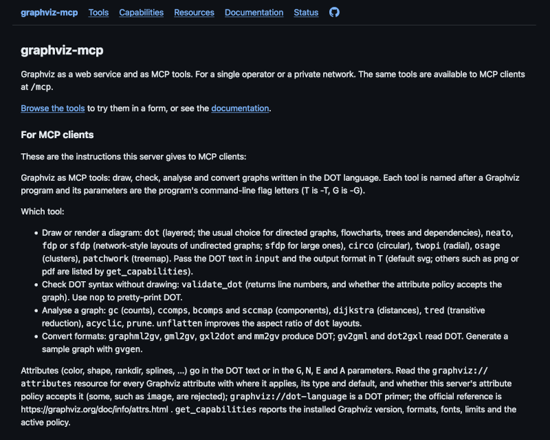
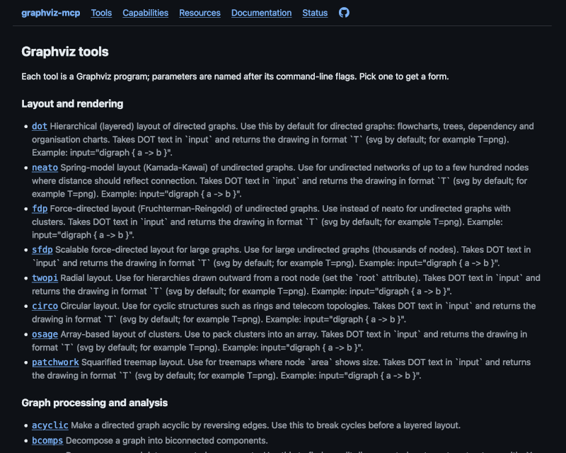
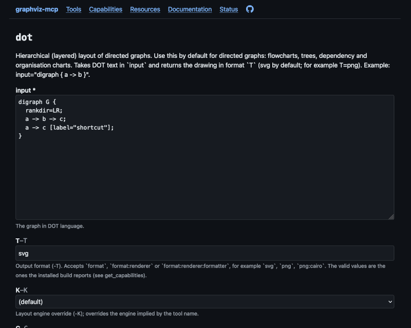
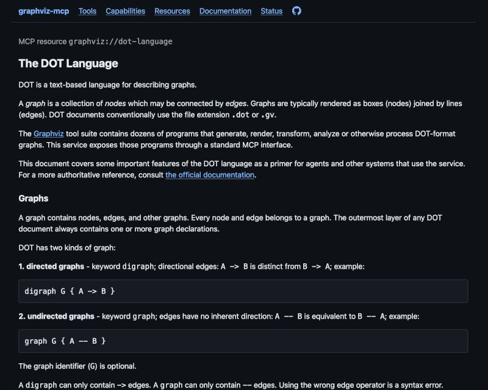
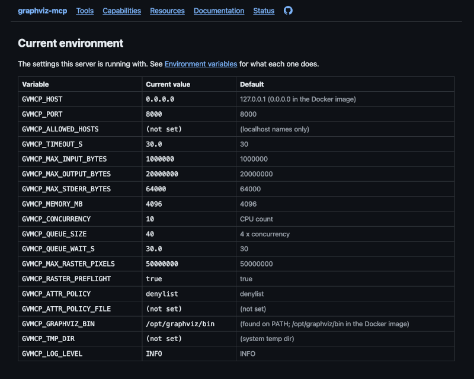

# Web UI

In HTTP mode the server also serves a small Web UI at `/ui`. It is a browser front end to the same service MCP clients use. You can try any tool by hand, read the resources, and see how the server is configured.

The pages are rendered on the server from the same tool table as the MCP schemas. They use plain HTML forms, with no JavaScript and no cookies. The UI is not available with `--stdio`.

Calls made through the UI go through the same code as MCP calls, so they get the same attribute policy, limits and concurrency queue.

## Pages

| Path | What it shows |
|---|---|
| `/ui` | A short introduction, and the instructions the server sends to MCP clients. |
| `/ui/tools` | Every tool, grouped as in [mcp-service.md](mcp-service.md). |
| `/ui/tools/<name>` | A form for each tool. |
| `/ui/capabilities` | Versions, layout engines, output formats and renderers, the attribute policy, limits and fonts, plus the raw JSON. |
| `/ui/resources` | The MCP resources as pages: `dot-language`, `attributes` and `capabilities`. |
| `/ui/docs` | Reference pages for the environment variables and the attribute security policy. |
| `/ui/status/current-env` | The current environment variable [configuration](configuration.md) the server is running with. |
| `/health` | Liveness. (JSON) |
| `/ready` | Readiness. Returns 503 until the capability check has passed and a trivial `dot` run works. (JSON) |
| `/version` | The service, Graphviz, Python and MCP SDK versions. (JSON) |
| `/ui/legal` | The license and the third-party notices. |

## Running a tool

`/ui/tools` lists the same tools an MCP client sees, with a one-line description of each.

Each tool page is a form built from the tool's parameters. Fields are named after the command-line flags, and the flag letter is shown beside each label. The graph goes in a text box, pre-filled with a small example. The `G`, `N`, `E` and `A` fields take one `name=value` pair per line. Fields such as the output format and layout engine offer the values the installed Graphviz reports.

Submitting the form runs the tool and shows the result above the form, so you can adjust the input and run it again.

* Images appear inline with a download link.
* Text formats such as SVG and DOT show the source. SVG is also drawn as an image. Each has a download link.
* Other formats, such as PDF, show the type and size with a download link.
* Graphviz warnings appear under "Messages from Graphviz".
* A rejected or failed call shows an error box instead of a result. It says whether the attribute policy refused the input, the server was busy, the run timed out, or the input was invalid. Policy rejections link to the active policy.

`validate_dot` has a form like the others. It reports whether the DOT is valid and whether the attribute policy accepts it, and shows the full JSON report below. `get_capabilities` opens the capabilities page.

## Resources

`/ui/resources` renders each MCP resource as a page, labeled with its `graphviz://` URI. The DOT language primer and the attribute list are the ones to read here. The attribute list shows whether the active policy accepts each attribute.

## Status

`/ui/status/current-env` lists each `GVMCP_*` variable with the value in effect and its default, which is the quickest way to confirm what a running container was started with. See [configuration.md](configuration.md) for what each one does.

